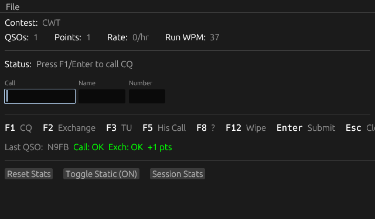
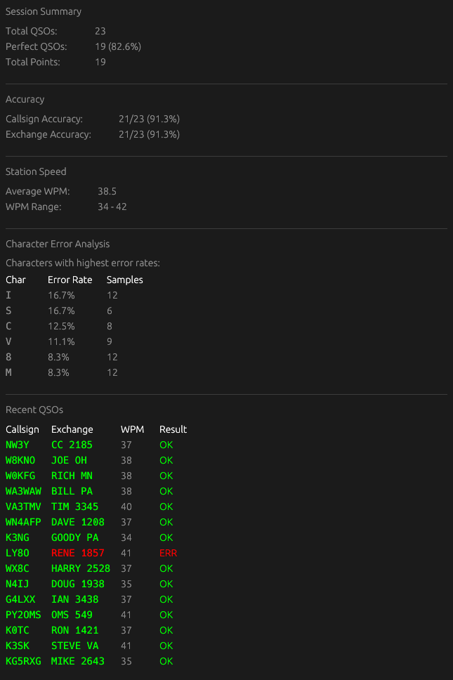

[](https://github.com/chadsbrown/contest_trainer/actions/workflows/release.yml)

# CW Contest Trainer

A practice tool for amateur radio CW (Morse code) contest operators. Simulate realistic contest conditions and improve your copying and logging skills.




## Quickstart

1. **Download the zip** for your platform from the [Releases page](https://github.com/chadsbrown/contest_trainer/releases):
   - Windows: `contest_trainer-<version>-windows-x86_64.zip`
   - macOS Intel: `contest_trainer-<version>-macos-x86_64.zip`
   - macOS Apple Silicon: `contest_trainer-<version>-macos-aarch64.zip`
   - Linux: `contest_trainer-<version>-linux-x86_64.zip`

2. **Unzip** the archive. It contains a `contest_trainer/` folder with the binary and all callsign files (`callsigns.txt`, `cwt_callsigns.txt`, `arrldx_callsigns.txt`, `ss_callsigns.txt`).

3. **Run the application** from inside the `contest_trainer/` folder.
4. **Personalize settings** (File->Settings): set your callsign under User Settings, then pick a contest and fill in your exchange for it under Active Contest.
5. **Start running** by pressing F1/Enter to send your first CQ. If nobody answers, call again.

For a walkthrough of every setting and the operating flow, see the [User Guide](docs/user-guide.md).

## Features

- **Cross-platform Support**: Run on Windows, macOS, and Linux
- **Supported Contests**:
  - CWT
  - CQ WW
  - CQ WPX
  - ARRL Sweepstakes
  - ARRL DX CW
- **Persistent Caller Queue**: Stations find your frequency over time, stay across CQ cycles, retry based on “patience,” and eventually give up if not worked. On a quiet band some CQs go unanswered
- **Realistic Audio Simulation**: Hear CW signals with configurable speed, pitch, and signal strength variations, with optional QSB (fading)
- **Multiple Simultaneous Callers**: User-configurable number of callers
- **Background Noise**: Adjustable noise level, receiver bandwidth, static crashes and pops to simulate real band conditions
- **Call Correction**: If you send a busted callsign, the station will usually correct you before giving its exchange (and sometimes won't, leaving you with a busted call)
- **Callers Asking for Repeats**: Callers occasionally ask you to send your exchange again
- **Tail-Ender Support**: After your TU, stations that lost out in the pileup call again and new ones may tail-end, without waiting for your next CQ (or not)
- **Partial Call Queries**: Use F5 to query a partial callsign when you can't copy the full call
- **Score Tracking**: Track QSOs, points, and hourly rate
- **Session Statistics**: Detailed performance analysis including accuracy rates, streaks, WPM statistics, and character-level error tracking, exportable to a Markdown file
- **Persistent Settings**: Your configuration is saved between sessions

## Downloads

Pre-built binaries for Windows, macOS (Intel and Apple Silicon), and Linux are available on the [Releases page](https://github.com/chadsbrown/contest_trainer/releases).

## Keyboard Controls

| Key | Function |
|-----|----------|
| F1 | Send CQ |
| F2 | Send your exchange only |
| F3 | Send TU (thank you) |
| F5 | Send his call only (contents of the callsign field) - use it to query a partial callsign |
| F8 | Request repeat (?). The station repeats its exchange once it has sent it, its callsign before that |
| F12 | Wipe (clear callsign and exchange fields) |
| Enter | Callsign field: send his call + your exchange (or CQ if the field is empty). Exchange field: log the QSO and send TU |
| Tab / Shift+Tab | Move to the next / previous field |
| Space / Shift+Space | Move to the next / previous field |
| Up Arrow | Increase your WPM (max 50) |
| Down Arrow | Decrease your WPM (min 15) |
| Esc | Stop your transmission. Stations keep sending, and you can carry on with Enter, F2, F5 or F8 |

## UI Controls

The main window includes several buttons at the bottom:

- **Reset Stats**: Clear all QSO statistics and start fresh
- **Toggle Static**: Enable/disable background noise
- **Session Stats**: Open a detailed statistics window showing accuracy, streaks, F5/F8 usage, WPM analysis, character error rates, and recent QSOs. Its **Export Stats** button writes the session to a Markdown file (`CWCT-<callsign>-<date>-<time>.md`) in the Stats Export Directory, or the current directory if none is set

## Settings

Access settings via File > Settings. The settings window opens as a separate window.

### User Settings

- **Your Callsign**: Your amateur radio callsign
- **Your WPM**: Speed for your transmitted CW (15-50)
- **Font Size**: UI font size
- **AGN Message**: Message sent when requesting a repeat (default: "?")
- **Show Status Line**: Show or hide the status line that says what is happening and what to do next
- **Show Main Field Hints**: Show placeholder hints in the callsign and exchange fields
- **Stats Export Directory**: Where exported session statistics are written

### Contest Settings

- **Contest Type**: Select from CWT, CQ World Wide, CQ WPX, ARRL Sweepstakes, or ARRL DX CW

### Active Contest

Settings for the selected contest. Each contest keeps its own.

- **CQ Message**: Your CQ message (default: "CQ TEST"); your callsign is appended
- **Callsign File**: Callsign file used by the selected contest. Callers come from this file, and a small built-in list is used if it cannot be read
- **Serial Min / Serial Max (CQ WPX, Sweepstakes)**: Range of serial numbers sent by callers (1-12000; default 1000-2500 for CQ WPX, 100-400 for Sweepstakes)
- **Your Exchange**: What you send, which depends on the contest:
  - CWT: Your Name, Your Number
  - CQ World Wide: Your Zone
  - CQ WPX: nothing to set (5NN plus a serial number that counts up from 001)
  - ARRL Sweepstakes: Your Precedence, Your Check, Your Section (plus a serial number that counts up)
  - ARRL DX CW: Your Exchange (state/province, or power if you are DX)

### Simulation Settings

- **Max Simultaneous Stations**: How many stations can call at once (1-5)
- **Station Probability**: How busy the band is - how often new stations find your frequency. Low values leave some CQs unanswered
- **WPM Range**: Speed range for calling stations
- **Filter Width**: Total spread between calling stations (Hz). Offsets are ± half the width. Default 300 Hz (min 100, max 500).
- **Signal Strength Range**: Volume variation between stations
- **Caller Needs Repeat Probability**: Chance that a caller will send "AGN" or "?" requesting you repeat your exchange
- **Filter Callers by Country**: Enable/disable country-based caller filtering. When enabled, controls the mix of domestic vs DX callers
- **Same Country Probability**: (Only shown when filter is enabled) Controls how often callers are from your same DXCC country (0.0-1.0). Lower values mean more DX callers, higher values mean more domestic callers. Default is 0.1 (10% domestic). Uses cty.dat for country lookups based on callsign prefixes.

### Audio Settings

- **Tone Frequency**: Base pitch for CW tones (Hz)
- **Noise Level**: Background noise intensity
- **Noise Bandwidth**: Width of the receiver filter applied to the noise (100-1000 Hz)
- **Master Volume**: Overall audio volume
- **Mute RX during TX (callers + noise)**: Realism (probably for most people this is more realistic.  yes, there are exceptions.)
- **Mute sidetone during TX**: Mute your own transmitted audio while sending
- **Static/QRN Settings**: Control static crashes, pops/clicks, and atmospheric noise
- **Enable QSB**: Simulate realistic signal fading on caller signals
  - **Fade Depth**: How much the signal fades (0 = none, 1 = full fade to silence)
  - **Fade Rate**: Fading cycles per minute (higher = faster fading)

## Callsign Files

### Standard Format (callsigns.txt)

One callsign per line. Lines starting with `#` are comments.

```
# Example callsigns
W1AW
K5ZD
N1MM
```

### CWT Format (cwt_callsigns.txt)

CSV format with callsign, name, and member number (or state/country).

```
# callsign, name, member_number
W1AW, JOE, 1
K5ZD, RANDY, 2
W9RE, MIKE, IN
```

### ARRL DX Format (arrldx_callsigns.txt)

CSV format with Call, Name, State, Power, UserText. Provide either State or Power (not both).

```
# Call,Name,State,Power,UserText
2E0CVN,,,50,
K3LR,,PA,,
3Z0X,,,K,
```

### Sweepstakes Format (ss_callsigns.txt)

CSV format with Call, Sect, State, CK, UserText. Section and Check are required; State and UserText are ignored.

```
# Call,Sect,State,CK,UserText
K1ABC,CT,,94,
W7RN,WWA,,05,
```

## Building from Source

Requires Rust toolchain.

```bash
# Clone the repository
git clone https://github.com/chadsbrown/contest_trainer.git
cd contest_trainer

# Build release binary
cargo build --release

# Run
./target/release/contest_trainer
```

### Windows - vcruntime140.dll

If the program fails to start with an error about this DLL being missing, you should try installing the package here (provided by Microsoft) that corresponds to your system architecture.  At the moment, I'm only providing builds for x64, so I imagine you'd need the x64 version.

https://learn.microsoft.com/en-us/cpp/windows/latest-supported-vc-redist?view=msvc-170#latest-supported-redistributable-version

A user reported that this fixed their issue.

### Linux Dependencies

On Linux, you may need to install audio and GUI dependencies:

```bash
# Debian/Ubuntu
sudo apt-get install libasound2-dev libxcb-render0-dev libxcb-shape0-dev libxcb-xfixes0-dev libxkbcommon-dev
```

## Documentation

- [User Guide](docs/user-guide.md): settings and operating flow in detail
- [State Machine](docs/STATE_MACHINE.md): how the QSO flow works internally
- [Adding Contests](docs/ADDING_CONTESTS.md): how to add a new contest
- [Specification](SPECIFICATION.md): full behavior reference

## Configuration Location

Settings are stored in:
- Linux: `~/.config/contest_trainer/settings.toml`
- macOS: `~/Library/Application Support/contest_trainer/settings.toml`
- Windows: `%APPDATA%\contest_trainer\settings.toml`

## Acknowledgements

Thanks to the following projects:
- [Amateur Radio Country Files](https://www.country-files.com/) (AD1C) for CTY.DAT files, which are used in this project
- [N1MM+ Logger](https://n1mmwp.hamdocs.com/) dev team, whose callsign history files are used in this project
- [Super Check Partial](https://www.supercheckpartial.com/) team, whose work is used in this project

Special thanks to the following people, who contributed feedback/ideas to the development of this application:
- KD9UYC
- DJ5CW
- N9TTK
- N0RC

This application was created collaboratively with [Claude](https://www.anthropic.com/claude) and [Codex](https://openai.com/codex).

## About

I created this for myself (N9UNX), but perhaps you might enjoy using it also.  There are several wonderful contest trainers (MorseRunner, G4FON, etc.) out there, and I've used them all.  They have their quirks, but they really helped me improve, and I can't thank the authors of those programs enough for their contributions.  That said, I always wanted something that was cross-platform (or was meant for Linux), so I decided to create this application.  It's still a work in progress, but complete enough that I am already using it as my main practice tool.  (Note:  it is overstatement to say that I created it, by a lot.  Claude (Opus) and Codex (gpt-5.2) created 99% of it -- I merely provided requirements and prompts to get what I wanted, only fixing a few things here and there by hand.)

## Roadmap

- Perhaps add more contests, if people want them (I imagine they will).  Honestly, I could live with just the CWT as the exchange is great practice (w/o a history file, as it is here, and in my opinion how it should be for a practice tool like this).
- Perhaps think about what 2BSIQ would be like, and how it should operate. (presently testing, but more work needed)
- Feedback welcome.

## License

MIT License
